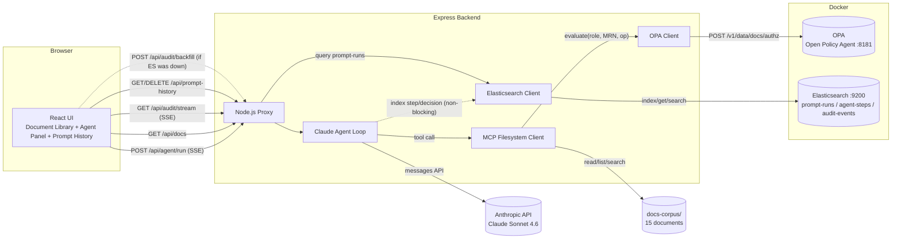

# AI Document Hub

A React/TypeScript dashboard that demonstrates **AI agent orchestration** via the [Model Context Protocol (MCP)](https://modelcontextprotocol.io/), secured by [Open Policy Agent (OPA)](https://www.openpolicyagent.org/) and Rego policies. Every AI tool call is gated by fine-grained, role-based access control — and every policy decision is visible in a real-time audit trail.

> **Note:** This app does not integrate the actual [Manetu Policy Engine (MPE)](https://manetu.github.io/policyengine). It uses OPA directly to illustrate the kinds of tool-call-level, MRN-based authorization use cases MPE is designed to solve.

> **Built with Claude** — this project was developed using [Claude Code](https://claude.ai/code) (Anthropic's AI coding agent) for implementation, architecture decisions, and iterative UI refinement.

## Why This Project Matters

This project makes AI agent security **visible and interactive**. You can watch every tool call get checked by OPA in real time, switch roles to see access change instantly, and toggle security off to see exactly what the policy layer prevents.

- **Watch** an AI agent (Claude Sonnet 4.6) answer questions by reading documents across sensitivity tiers
- **See** every tool invocation evaluated **before** execution — with allow/deny decisions in real time
- **Switch roles** instantly — a viewer can only read public docs, while an admin has full access
- **Browse prompt history** — every thinking step, tool call, MRN, policy rule, and final answer is recorded, durably indexed to Elasticsearch so it survives a server restart and stays searchable
- **Toggle security off** to compare — demonstrating exactly what the policy engine blocks

### The Problem

Traditional access control (RBAC, ACLs) was designed for humans navigating predefined workflows. AI agents break that model: they chain tool calls autonomously, access resources the user never explicitly requested, and can escalate through indirect paths.

Asking to "summarize all documents" triggers reads across every sensitivity tier — a role that's safe for a human clicking one file at a time becomes dangerously broad when an agent iterates the entire corpus in seconds.

### The Solution

This app uses [OPA](https://www.openpolicyagent.org/) with Rego policies to evaluate access at the **tool call level** using MRN-style resource identifiers (Manetu Resource Notation), the same model the [Manetu Policy Engine](https://manetu.github.io/policyengine) is built around. Instead of blanket "this user can access this service," it answers: _"Can a viewer-role agent invoke `read-file` on a confidential document right now?"_ — and produces a structured audit record for every decision. This is a demonstration of the use case MPE targets, not an integration with MPE itself.

## Architecture



## Roles and Access

### Document Access by Sensitivity Tier

| Role | Public | Internal | Confidential |
|------|:------:|:--------:|:------------:|
| Viewer | Read | Denied | Denied |
| Developer | Read | Read | Denied |
| Data Analyst | Read | Read | Denied |
| Auditor | Read | Read | Read (read-only) |
| Admin | Full | Full | Full |

### Tool Permissions

| Role | list-directory | read-file | keyword-search |
|------|:--------------:|:---------:|:--------------:|
| Viewer | Yes | No | No |
| Developer | Yes | Yes | Yes |
| Data Analyst | Yes | Yes | Yes |
| Auditor | Yes | Yes | No |
| Admin | Yes | Yes | Yes |

Tool access is enforced at the MRN level. Even if a role has `read-file` permission, the document's sensitivity tier is checked separately — a developer with `read-file` access will still be denied when attempting to read a confidential document.

## Example: A Denied Request

Here's what actually happens end-to-end when a policy blocks a tool call — using the "developer can't read confidential docs" case from the table above.

You're on the **Developer** role and ask the agent:

> "Summarize the Q3 financial results."

Claude decides to call the `read-file` tool with `path: "confidential/q3-financials.md"`. Before the file is touched, the backend ([`claude-agent.ts`](server/lib/claude-agent.ts)) runs it through OPA in up to two steps:

**1. Can `developer` invoke the `read-file` tool at all?**

```json
// POST /v1/data/docs/authz
{ "input": { "principal": "developer", "resource": "mrn:mcp:filesystem:tool:read-file", "operation": "invoke" } }
```
```json
{ "result": { "allow": true, "rule": "developer-read-file", "reason": "Developer role can read files" } }
```

Allowed — `read-file` is a generic tool grant, though, so it doesn't know *which* document is being read. So the backend runs a second check derived from the file's path (`confidential/...`):

**2. Can `developer` `read` the `confidential` sensitivity tier?**

```json
// POST /v1/data/docs/authz
{ "input": { "principal": "developer", "resource": "mrn:mcp:docs:resource:confidential:*", "operation": "read" } }
```
```json
{ "result": { "allow": false, "rule": "default-deny", "reason": "No policy rule matched — access denied by default" } }
```

[`roles-data.json`](policies/roles-data.json) only grants the developer role `public:*` and `internal:*` document MRNs — there's no confidential grant — so [`docs-domain.rego`](policies/docs-domain.rego) falls through to its default-deny. The tool call is blocked before it reaches the filesystem:

- The **agent** gets a tool error of `Access denied by policy engine: default-deny` and has to work around it in its response instead of returning file contents.
- The **audit trail** (Prompt History panel, and `GET /api/audit/stream`) records a structured event:

```json
{
  "principal": "developer",
  "resource": "mrn:mcp:filesystem:tool:read-file",
  "operation": "invoke",
  "decision": "deny",
  "policyRule": "default-deny"
}
```

Switch to **Admin** or **Auditor** and ask the same question — both roles have an explicit `confidential:*` grant (`admin-unrestricted` and `auditor-confidential-read` respectively), so both checks pass and the agent reads and summarizes the document.

## Persistence: Prompt History & Audit Trail

Prompt runs, agent steps, and audit events are durably indexed to **Elasticsearch** rather than kept only in an in-memory buffer or the browser's `localStorage` — modeling the kind of long-term, searchable audit retention a real compliance requirement would demand.

- **Three flat indices**, joined by `agentTaskId` (no nesting): `prompt-runs` (one doc per task, upserted with denormalized allow/deny/bypass counts), `agent-steps` (one doc per step), and `audit-events` (one doc per policy decision).
- **Writes are non-blocking** — indexing happens off the same points that already emit SSE events (`onTaskStart`, `onStep`, `onAudit`) via fire-and-forget calls, so an Elasticsearch hiccup never slows down or breaks a live agent run.
- **Local durability buffer** — the frontend always writes a finished run to its Zustand-backed local buffer first, unconditionally. A background sync loop (`useHistorySync`) retries `POST /api/audit/backfill` every ~15s; once Elasticsearch confirms the write, the run is cleared from the local buffer. This means an outage of any length — not just a brief blip — never loses data, and nothing is gated on a health check first, since the write attempt itself is the health check.
- **Reads go through the backend**, never straight to Elasticsearch from the browser: `GET /api/prompt-history` (list), `GET /api/prompt-history/:taskId` (full detail), `DELETE /api/prompt-history[/:taskId]` (clear one or all), plus `GET /api/audit/health` for the sync loop's advisory status check.

Elasticsearch runs locally via the `elasticsearch` service in `docker/docker-compose.yml` (single-node, security disabled — local dev only) — no cloud account or API key needed. If it's not running, prompt history simply falls back to the local buffer until it comes back.

## Quick Start

### Prerequisites

- Node.js 20+
- Docker Desktop (for the OPA policy engine and Elasticsearch)
- Anthropic API key ([console.anthropic.com](https://console.anthropic.com/settings/keys))

### Install and Run

```bash
git clone <repo-url>
cd manetu-document-hub
npm install

# 1. Start the policy engine and Elasticsearch
docker compose -f docker/docker-compose.yml up -d

# 2. Set up environment
cp .env.example .env
# Edit .env and add your ANTHROPIC_API_KEY

# 3. Run the app
npm run dev:all          # Vite on :5173 + Express on :3001
```

The app will be at **http://localhost:5173**.

### Running Without Docker

The app works without Docker. If OPA is unreachable when security is enabled, the backend returns a clear error — you can disable the policy engine via the toggle in the header to use the agent without OPA. If Elasticsearch is unreachable, prompt history and audit events are simply held in the browser's local durability buffer and synced automatically once it's back (see [Persistence](#persistence-prompt-history--audit-trail)) — nothing else about the app degrades.

### Environment Variables

| Variable            | Description                                              |
| ------------------- | -------------------------------------------------------- |
| `ANTHROPIC_API_KEY` | Claude API key (required for agent)                      |
| `MPE_BASE_URL`      | OPA policy engine URL (default: `http://localhost:8181`) — name kept for MRN-style compatibility with MPE |
| `MCP_DOCS_PATH`     | Path to document corpus (default: `./docs-corpus`)       |
| `ELASTICSEARCH_URL` | Elasticsearch URL for prompt history/audit persistence (default: `http://localhost:9200`) |
| `PORT`              | Backend server port (default: `3001`)                    |

## UI Overview

### Three-Panel Layout

The dashboard is three independent panels — **Document Library**, **Agent Task View**, and **Prompt History** — that default to that left-to-right order but aren't fixed to it: each panel's header has move buttons to swap it with its neighbor, and a drag handle between panels lets you resize them. Layout order persists across reloads; panel width resets to its default whenever panels are reordered.

- **Document Library**: Browse 15 documents organized by sensitivity tier (public/internal/confidential). Documents show sensitivity badges and lock icons based on the active role. Click to preview in a document-viewer-style modal — the markdown renders inside a distinct "page" card with the file's path shown, rather than as raw text filling the dialog.

- **Agent Task View**: Chat interface powered by Claude Sonnet 4.6. Type a question or click a suggested prompt. The agent reads documents, respects policy checks, and streams responses. Shows task status (running/completed/failed) with stop and new task controls.

- **Prompt History**: Master-detail view, backed by Elasticsearch (see [Persistence](#persistence-prompt-history--audit-trail)). The list shows all past prompt runs with role, timestamp, and allow/deny counts. Click any run to see the full step trace: thinking cards, tool call cards with MRN and policy decision badges, and the final markdown answer with source citations.

### Control Bar

The control bar sits below the brand bar and holds everything that changes how the agent is allowed to behave:

- **Role** — a dropdown with all 5 roles (Viewer, Developer, Data Analyst, Auditor, Admin), each with a color-coded dot. Switching roles is instant — it just changes which principal is sent on subsequent requests — and shows a toast confirming the switch. Next to it, an info icon opens a popover listing the active role's exact document-tier and tool permissions (allow/deny), sourced from the same [`roles-data.json`](policies/roles-data.json) grants OPA evaluates against.

- **Policy engine toggle** — an Enabled/Disabled switch (green when on, red when off). Turning it off opens a confirmation dialog warning that *all* AI tool calls will execute without policy checks, regardless of role; confirming flips `securityEnabled` in the store, which — per the [example above](#example-a-denied-request) — makes the backend skip the OPA calls entirely and auto-allow every tool call with `rule: "security-disabled"`. The switch is disabled while an agent task is actively running, so you can't change security mid-request.

- **Theme toggle** — a single icon button on the right edge that flips between dark and light mode (persisted via Zustand/localStorage).

### Security Demo Mode

Toggle the policy engine off to see the difference:

- **Enabled**: Every tool call is checked against OPA. Denied calls show the policy rule that blocked them.
- **Disabled**: All tool calls bypass security. A red warning banner appears. Audit events show "BYPASSED" instead of "ALLOWED"/"DENIED".

## Document Corpus

15 realistic fake company documents in `docs-corpus/`:

| Tier             | Count | Examples                                                                             |
| ---------------- | ----- | ------------------------------------------------------------------------------------ |
| **Public**       | 5     | Company overview, product announcement, engineering blog, security FAQ, job postings |
| **Internal**     | 5     | Team wiki, 2026 roadmap, incident postmortem, hiring pipeline, AI strategy draft     |
| **Confidential** | 5     | Q3 financials, board update, M&A analysis, compensation bands, security audit        |

Each document has YAML frontmatter with `title`, `sensitivity`, `category`, `author`, `date`, and `excerpt`.

## Testing

```bash
# Unit tests (Vitest + React Testing Library)
npm test                 # watch mode
npm run test:coverage    # single run with coverage

# E2E tests (Cypress)
npm run build && npm run preview   # start the preview server first
npm run cypress:open                # interactive mode
npm run cypress:run                 # headless (CI)
```

## Project Structure

```
src/
  components/
    dashboard/       App shell, header, panels, role switcher, security toggle
    agent/           Agent task panel, step trace cards, prompt history
    audit/           Audit event rows, audit log panel
    docs/            Document library, doc cards, sensitivity badges, preview modal
  hooks/
    useAgentRun.ts   SSE stream parser for agent runs
    useAuditStream.ts  EventSource connection to audit SSE endpoint
    useDocLibrary.ts   Fetches docs with role-based access flags
    useDocContent.ts   Fetches document content for preview
    usePromptHistory.ts     Fetches prompt run list from Elasticsearch (via backend)
    usePromptRunDetail.ts   Resolves a run's full detail — local if live/unsynced, fetched otherwise
    useHistorySync.ts       Retries syncing the local durability buffer to Elasticsearch
  lib/
    api.ts               Typed fetch wrapper (auto-attaches x-role, x-security-enabled)
    prompt-history-api.ts Prompt history fetch/delete/export, local-vs-backend resolution
    store.ts             Zustand store — role/security/theme state, plus the local
                         write-side durability buffer for prompt history (see Persistence)
    theme.ts             MUI theme (dark/light mode, blue/teal brand palette)
  types/
    index.ts         All domain types (single source of truth)
  pages/
    Dashboard.tsx    Main page layout
server/
  index.ts           Express entry point
  routes/
    agent.ts           POST /api/agent/run — SSE streaming agent orchestration
    tools.ts           GET /api/tools — OPA-filtered tool list with 60s cache
    docs.ts            GET /api/docs — doc list; GET /api/docs/content/:path — doc content
    audit.ts           GET /api/audit/stream — persistent SSE audit broadcast;
                       GET /api/audit/health, POST /api/audit/backfill
    prompt-history.ts  GET/DELETE /api/prompt-history[/:taskId] — reads/deletes in Elasticsearch
  middleware/
    roleExtract.ts   x-role header validation
  lib/
    claude-agent.ts  Agent loop: Claude API → OPA check → tool execution → SSE emit
    mpe-client.ts    Typed OPA client (evaluate + discover)
    mcp-fs-client.ts Filesystem client (list, read, keyword search with frontmatter)
    audit-bus.ts     Event bus with 50-event ring buffer
    tool-registry.ts 6 MCP tool definitions with MRNs
    es-client.ts     Elasticsearch client, index creation, health check
    audit-index.ts   Prompt run / step / audit event indexing and queries
docker/
  docker-compose.yml     OPA policy engine (port 8181) + Elasticsearch (port 9200)
  docker-compose.ci.yml  CI override
policies/
  docs-domain.rego   OPA Rego policy (default-deny, MRN wildcard matching)
  roles-data.json    Role grants for all 5 roles
cypress/
  e2e/               E2E test specs
  fixtures/          Mock API responses (12 fixture files)
  support/           Custom commands (switchRole, toggleSecurity, etc.)
docs-corpus/
  public/            5 public documents
  internal/          5 internal documents
  confidential/      5 confidential documents
```

## CI/CD

GitHub Actions pipeline (`.github/workflows/ci.yml`) runs on every push to `main` and all PRs:

1. **Lint** — `eslint --max-warnings 0`
2. **Typecheck** — `tsc --noEmit` (frontend + server)
3. **Unit tests** — `vitest run --coverage`
4. **Build** — `vite build`
5. **Cypress E2E** — headless Chrome against `vite preview`

No API keys or Docker required in CI — Cypress tests use `cy.intercept()` to mock all backend calls.

## Tech Stack

| Layer            | Technology                                                       |
| ---------------- | ---------------------------------------------------------------- |
| Frontend         | React 19, TypeScript, MUI v7, Zustand (persisted), Framer Motion |
| Backend          | Express 5, Node.js 20                                            |
| AI               | Claude Sonnet 4.6 (Anthropic SDK)                                |
| Policy Engine    | OPA (Open Policy Agent) with Rego policies                       |
| Audit Storage    | Elasticsearch 8.15 (`@elastic/elasticsearch`)                    |
| Document Parsing | gray-matter (YAML frontmatter)                                   |
| Markdown         | react-markdown + remark-gfm                                      |
| Testing          | Vitest, React Testing Library, MSW, Cypress                      |
| Build            | Vite 7                                                           |
| CI               | GitHub Actions                                                   |
